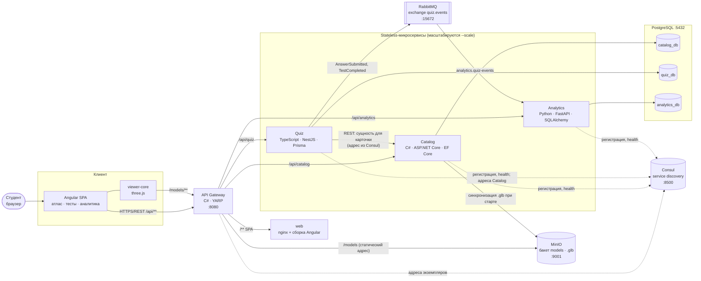
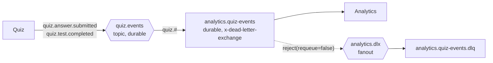
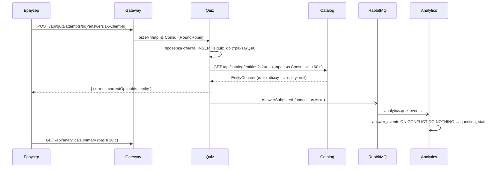
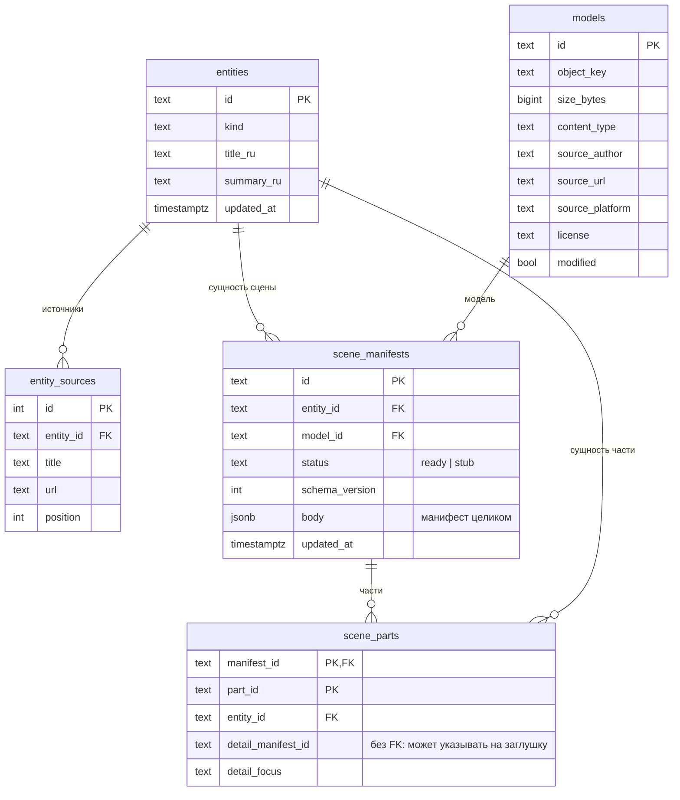
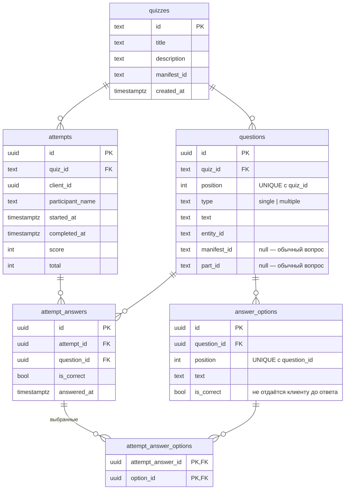
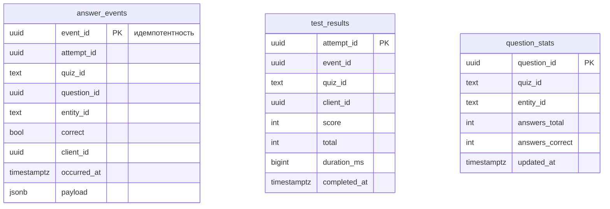

# Архитектура стенда лабораторной

Документ описывает то, что работает в ветке `lab-backend` (состояние на 17.11.2026). Контракты API и событий — `docs/lab/contracts.md`, запуск и учётные данные — `deploy/README.md`, сценарий показа — `docs/lab/demo.md`.

## Схема компонентов

Ключевое решение — **один origin**: браузер ходит только на gateway `:8080`, поэтому `model.url` в манифестах (`models/animal-cell/v1/…`) работает без изменений и CORS не нужен.

## Компоненты

### Клиент (Angular + viewer-core)
- **Что делает.** Три экрана: «Атлас» (3D-модель клетки и детальные модели органоидов, сноски, расслоение, справочник), «Тесты» (модель слева, панель теста справа; вопросы «Что выделено на модели?» с подлётом камеры и изоляцией части), «Аналитика» (сводка, самые трудные органоиды, статистика по вопросам; автообновление раз в 10 с).
- **Как получает данные.** Только через репозитории за `InjectionToken`: `STRUCTURE_REPO` (`HttpStructureRepository` → Catalog), `QUIZ_REPO` (→ Quiz), `ANALYTICS_REPO` (→ Analytics). Модели `.glb` грузит ядро `viewer-core` по `/models/...`.
- **Пользователь.** Анонимный; `clientId` (UUID) хранится в `localStorage` и отправляется в заголовке `X-Client-Id` — по нему Quiz отдаёт попытку только её владельцу.
- **В контейнере.** `web` — nginx со статикой сборки; наружу не публикуется, отдаётся через gateway.

### API Gateway (C#, YARP) — `services/gateway`
- **Маршруты.** `/api/catalog/**`, `/api/quiz/**`, `/api/analytics/**` → соответствующие сервисы; `/models/**` → `http://minio:9000` без изменения пути; `/**` → `web`.
- **Service discovery.** `ConsulDiscoveryService` опрашивает `GET /v1/health/service/{name}?passing=true` сразу при старте, затем каждые 5 с; при изменении набора адресов `ConsulProxyConfigProvider` публикует новую конфигурацию YARP. Consul недоступен → используется последний известный набор.
- **Балансировка и отказоустойчивость.** `RoundRobin`; пассивные проверки здоровья (`TransportFailureRate`, окно и реактивация 10 с); повтор идемпотентных `GET`/`HEAD` на другом экземпляре при транспортной ошибке (до 3 попыток); `ConnectTimeout` 2 с. Нет экземпляров → `503 {"error":"service_unavailable"}`.

### Catalog Service (C#, ASP.NET Core + EF Core + Npgsql) — `services/catalog`, БД `catalog_db`
- **Что делает.** Хранит и отдаёт содержимое атласа: манифесты сцен (как `jsonb` целиком + нормализованные части) и тексты сущностей (органоидов). API: `GET /api/catalog/manifests[/{id}]`, `GET /api/catalog/entities[/{id}|?ids=]`.
- **Старт.** Фоновая служба: ждёт БД → применяет миграции → seed из `projects/app/public` (под `pg_advisory_xact_lock`, одна транзакция, повторный старт ничего не меняет) → синхронизация `.glb` в MinIO (при **каждом** старте, через S3 API, с ретраями). Пока шаги не пройдены, `/health` = `503` и Consul не пускает трафик.

### Quiz Service (TypeScript, NestJS + Prisma) — `services/quiz`, БД `quiz_db`
- **Что делает.** Тесты, вопросы, варианты, попытки и ответы; проверка ответов (`single` / `multiple`, пустой ответ = «Не знаю»). API: `GET /api/quiz/quizzes[/{id}]`, `POST /api/quiz/attempts`, `POST …/answers`, `POST …/complete`, `GET /api/quiz/attempts/{id}`. Признак правильного ответа не уходит клиенту до ответа на вопрос.
- **Состояние.** Попытка хранится в БД, а не в памяти экземпляра — поэтому Quiz масштабируется и переживает отказ экземпляра посреди теста. Ответ и завершение сериализуются `SELECT … FOR UPDATE` по строке попытки.
- **Прямая связь с Catalog.** `CatalogClient` берёт адреса Catalog из Consul (список на 5 с, по кругу), таймаут 2 с, кэш сущностей в памяти 60 с. Catalog недоступен → `entity: null`, ответ проверяется как обычно (деградация, а не ошибка).
- **События.** После коммита публикует в RabbitMQ `AnswerSubmitted` и `TestCompleted` (persistent, publisher confirms, `message_id = eventId`); брокер недоступен → ответ пользователю всё равно успешный.
- **Старт.** `prisma migrate deploy` в entrypoint, затем seed двух тестов, если `quizzes` пуста.

### Analytics Service (Python, FastAPI + SQLAlchemy async + aio-pika) — `services/analytics`, БД `analytics_db`
- **Что делает.** Потребляет события Quiz и считает статистику. API: `GET /api/analytics/summary`, `GET /api/analytics/entities`, `GET /api/analytics/questions?quizId=`.
- **Потребитель.** Очередь `analytics.quiz-events` (привязка `quiz.#`), `prefetch 10`, ручной `ack`. Валидация Pydantic; невалидное → `reject(requeue=false)` → `analytics.dlx` → `analytics.quiz-events.dlq`. Идемпотентность по `eventId`: `INSERT … ON CONFLICT DO NOTHING RETURNING`, и только при вставке — инкремент `question_stats`, в одной транзакции. Ошибка БД → `nack(requeue=true)` с паузой 1 с.
- **Старт.** Схема — `metadata.create_all` под advisory-блокировкой; потребитель запускается в lifespan с ретраями подключения.

### Инфраструктура
| Компонент | Образ | Роль |
|---|---|---|
| PostgreSQL | `postgres:18.7-alpine` | одна инстанция, три БД и три пользователя с доступом только к своей БД |
| RabbitMQ | `rabbitmq:4.4.0-management-alpine` | брокер событий Quiz → Analytics, UI управления |
| Consul | `hashicorp/consul:1.22.7` (dev-режим) | реестр сервисов и health checks |
| MinIO | `pgsty/minio:RELEASE.2026-08-04T00-00-00Z` | объектное хранилище `.glb`, бакет `models` с анонимным чтением |
| web | `nginx:1.31.8-alpine` | статика Angular |

Все сервисы регистрируются в Consul с IP контейнера, `ID = <name>-<hostname>`, HTTP health check `/health`, повторной регистрацией каждые 30 с (переживает перезапуск Consul) и снятием регистрации при остановке.

## Взаимодействия

| Откуда → куда | Тип | Как | Зачем |
|---|---|---|---|
| Браузер → Gateway | синхронно, HTTP | REST `/api/**`, `/models/**`, SPA | единая точка входа |
| Gateway → Catalog / Quiz / Analytics | синхронно, HTTP | YARP, адреса из **Consul**, RoundRobin | маршрутизация и балансировка |
| Gateway → MinIO, web | синхронно, HTTP | статический адрес | модели и статика |
| **Quiz → Catalog** | **прямая связь**, HTTP | `GET /api/catalog/entities?ids=`, адрес из **Consul** | карточка органоида после ответа |
| **Quiz → Analytics** | **через брокер**, асинхронно | RabbitMQ `quiz.events` (topic): `quiz.answer.submitted`, `quiz.test.completed` | статистика без связности по времени |
| Catalog → MinIO | синхронно, S3 API | при каждом старте | синхронизация `.glb` |
| Сервисы → Consul | HTTP | регистрация + health check `/health` | обнаружение, вывод из ротации |
| Сервисы → PostgreSQL | TCP | своя БД у каждого | хранение |

### Топология RabbitMQ

### Поток «студент ответил на вопрос»

## Базы данных

Диаграммы построены по фактическим схемам в запущенных БД (`information_schema`), а не по плану.

### `catalog_db` (Catalog, EF Core, миграция `InitialCreate`)

### `quiz_db` (Quiz, Prisma, миграция `20261117000000_init`)

### `analytics_db` (Analytics, SQLAlchemy `create_all`)

Связей между таблицами нет намеренно: это проекция событий, ссылки на Quiz — логические (идентификаторы из событий).

## Соответствие требованиям ТЗ

| Требование | Чем закрыто |
|---|---|
| Фронтенд на Angular | `projects/app`: экраны «Атлас», «Тесты», «Аналитика» |
| ≥ 2 микросервиса на разных языках | Catalog (C#), Quiz (TypeScript), Analytics (Python) + Gateway (C#) |
| Прямая связь микросервисов | Quiz → Catalog по REST, адрес из Consul |
| Связь через брокер | Quiz → RabbitMQ → Analytics |
| БД, ≥ 5 проработанных сущностей | 5 таблиц в `catalog_db`, 6 в `quiz_db`, 3 в `analytics_db` |
| Consul | регистрация и health checks всех сервисов; Gateway и Quiz берут адреса из Consul |
| API Gateway | YARP: `/api/*`, `/models/*`, SPA; балансировка и отказоустойчивость |

## Не входит в минимальную версию

Redis (кэш и сессии), пользователи и роли, k6-нагрузка, outbox для событий, `AtlasContentUpdated` (`PUT` сущностей Catalog + сброс кэша в Quiz). Подробнее — `docs/lab/README.md`, «Потом».
